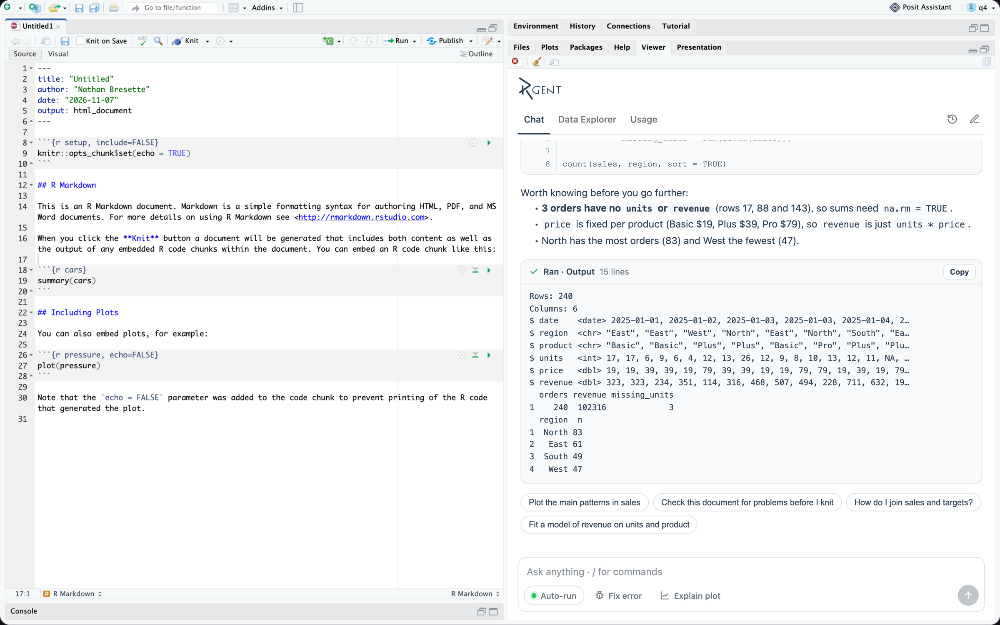
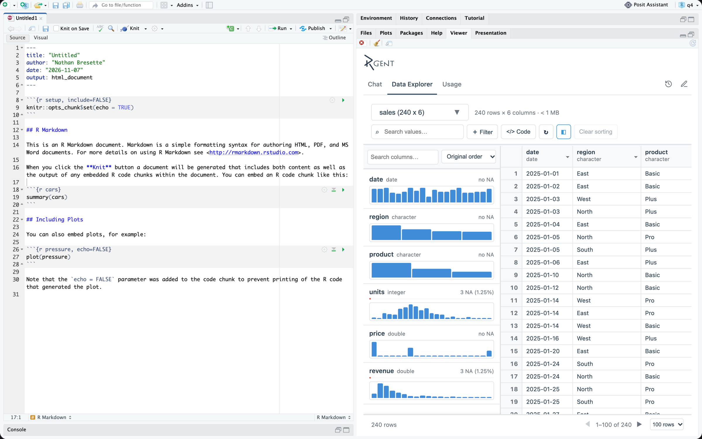

# Rgent

An AI assistant that lives inside RStudio. Rgent opens a chat pane in the Viewer that sees what you're working on: your data frames, the file open in the editor, and the last output or error. It can run code in your session, edit your file and explain your plots.

Get an access code at [rgentai.com](https://rgentai.com).

## Installation

```r
install.packages("remotes")
remotes::install_github("NathanBresette/Rgent-AI", upgrade = "never")

library(rstudioai)
run_rgent()   # opens the chat pane in RStudio's Viewer
```

After the first start, Rgent opens by itself when RStudio starts (`setup_rprofile_auto_start()` adds this to your `.Rprofile`). When a new version is installed, the chat tells you and offers **Restart R** to load it.

## Features

### Chat that knows your session



- Answers using your workspace: data frame sizes, column names and types, and the code in your open file.
- **Auto-run or Ask first:** code from a reply runs in your session, with its output and plots shown in the chat. Code that installs packages, deletes files, runs shell commands or restarts R always asks first.
- **Fixes its own errors:** when code fails, Rgent first repairs the session (for example, by running the R Markdown chunk that creates a missing object) and then asks for a fix.
- **A short summary of the result** after code runs, with the actual numbers.
- **Fix error** explains and fixes the newest error from your Console.
- **Explain plot** reads the plot itself and the values it draws.
- Slash commands: `/fix`, `/plot`, `/new`, `/history`, `/auto`.

### Edits to your open file

Rgent can change the file open in the editor (R scripts, R Markdown and Quarto). Each change appears as a red/green diff card with **Accept**, **Reject** and **Undo**. It flags edits that would break an R Markdown chunk. Long files are read and searched as needed.

### Data Explorer



- A grid for any data frame, fast on a million rows: sort, filter, search, pin columns.
- Column summaries and distributions.
- **Code** gives the `dplyr` (or base R) code for the current view.
- Lists, models, functions and other objects can be drilled into, with a copyable path to each part.
- Updates live when the data changes.

### Also

- Chat history saved on your computer only, with export to R Markdown.
- Usage shown in the pane.
- Plans run on Anthropic's Claude (Haiku or Sonnet).

## Privacy and security

- Your prompt and the context it needs are sent to Rgent's server, which forwards them to Claude. The server doesn't store your prompts or replies.
- Saved chats stay in `tools::R_user_dir("rstudioai", "data")` on your computer.
- The pane's local connection to R needs a secret made fresh for each R session, so other websites open in your browser can't reach it.
- Details: [rgentai.com/privacy.html](https://rgentai.com/privacy.html).

## Requirements

- R >= 4.0.0
- RStudio
- An internet connection
- An access code from [rgentai.com](https://rgentai.com)

## License

MIT. See [LICENSE](LICENSE).

## Citation

```bibtex
@software{bresette_rgent,
  title  = {Rgent: An AI Assistant for RStudio},
  author = {Bresette, Nathan},
  year   = {2026},
  url    = {https://github.com/NathanBresette/Rgent-AI}
}
```
